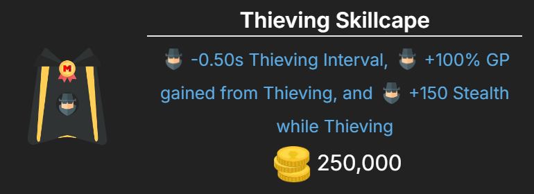
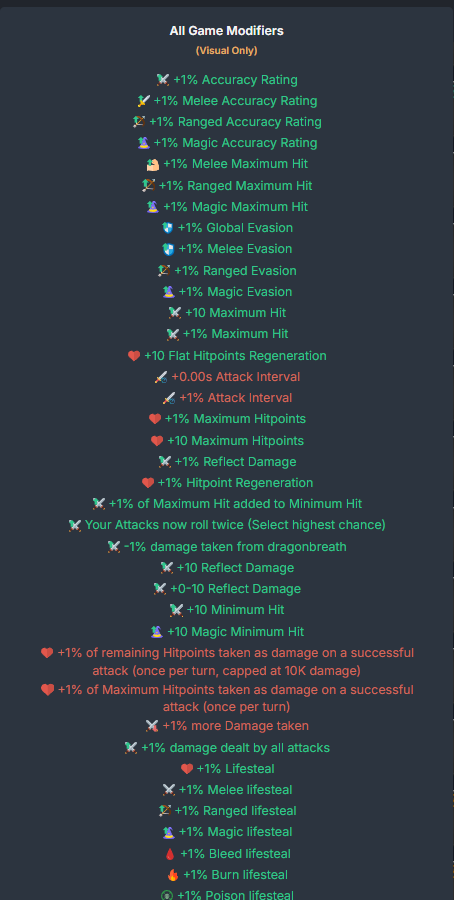

# Tiny Icons

A Melvor Idle mod on [Mod.io](https://mod.io/g/melvoridle/m/tiny-icons)

Adds tiny icons in front of modifier descriptions throughout the game: item tooltips, Agility, Astrology, summoning synergies, the shop, prayers, Cartography and more, including other mods' interfaces that show the game's modifier text. Works with Melvor Idle v1.3.1.

If you use "[Refurbished] Tiny Icons", remove it first: both use the same mod id.

## Settings

- **Enable Global Icons** (on): show icons everywhere. Off shows them only on the Agility and Astrology pages.
- **Enable Secondary Icons** (off): add a second icon for what the modifier applies to.

Both apply at once, without a reload.

## For mod developers

`mod.api.tinyIcons` keeps the 2.0 API: `addTagSources`, `addCustomModifiers`, `getIconTagsForModifier`, `getIconHTMLForModifier`, `getIconResourcePath`, `getAvailableTags`, `getAvailableTagsWithSources` and `viewAllModifiers`. Modifier keys from before v1.3 still work where the game knows them as aliases, and current modifier ids (e.g. `melvorD:skillXP`) work too.

